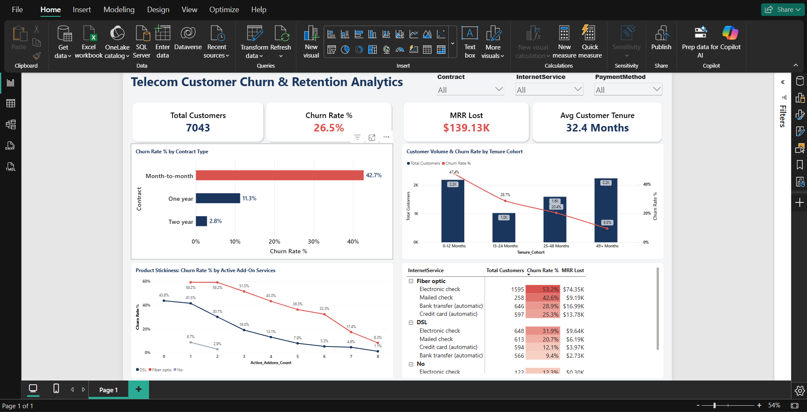

# Telecom Customer Churn & Retention Analytics

An end-to-end data analytics solution built to identify customer churn drivers, quantify Monthly Recurring Revenue (MRR) at risk, and uncover retention opportunities across 7,043 telecom subscribers.

## Dashboard Preview


## Business Problem
Subscription-based telecom providers lose significant recurring revenue when subscribers cancel their plans. Leadership and retention teams needed visibility into:
* Overall churn rate and total Monthly Recurring Revenue (MRR) lost.
* High-risk contract types, tenure drop-off windows, and billing payment frictions.
* Whether bundling add-on services (`TechSupport`, `OnlineSecurity`, `DeviceProtection`) improves customer retention.

## Tech Stack & Architecture
* **Python (Pandas, NumPy):** Data cleaning, null imputation for zero-tenure customers, categorical standardization, and feature engineering (`Tenure_Cohort`, `Revenue_Tier`, `Active_Addons_Count`).
* **SQL Server (T-SQL):** Normalized relational schema design (`dim_customers`, `dim_services`, `fact_billing_churn`) and analytical querying using CTEs, `CASE` logic, and window functions (`RANK`, `SUM OVER`).
* **Power BI Desktop (DAX):** Star-schema data modeling, custom KPI measures, interactive slicers, and conditional heatmap formatting.

## Repository Structure
```text
Telecom-Customer-Churn-Analytics/
├── data/
│   |
│   └── cleaned_telco_churn.csv                # Preprocessed dataset ready for SQL
├── script/
│   └── 01_churn_data_cleaning.ipynb           # Python data cleaning & feature engineering
├── sql/
│   └── 01_churn_analysis.sql                  # Star-schema DDL & T-SQL retention queries
├── dashboard/
│   ├── Telco_Churn_Retention_Dashboard.pbix   # Power BI Desktop report file
│   └── dashboard_overview.png                 # High-resolution dashboard screenshot
└── README.md
```

## Key Analytical Insights
1. **First-Year Onboarding Leak:** Subscribers in the `0–12 Months` tenure cohort exhibit the steepest churn rate (**47.4%**), accounting for the largest share of lost MRR before retention stabilizes after 24 months.
2. **Contract Type Impact:** Month-to-month subscribers churn at **42.7%**, nearly 4x higher than one-year contract holders (**11.3%**) and over 15x higher than two-year contract holders (**2.8%**).
3. **Billing & Service Friction:** Fiber Optic subscribers paying manually via **Electronic Check** represent the highest concentration of lost revenue (`$139.1K` total MRR lost across churned accounts).
4. **Product Stickiness:** Customers subscribed to 3 or more add-on services—particularly **Tech Support** and **Online Security**—demonstrate substantially lower churn rates than single-service subscribers.

## How to Run This Project
1. **Data Preprocessing:** Run `notebooks/01_churn_data_cleaning.ipynb` to clean the raw dataset and generate `cleaned_telco_churn.csv`.
2. **Database Setup:** Execute `sql/01_churn_analysis.sql` in Microsoft SQL Server Management Studio (SSMS) to build the normalized tables and run cohort/risk queries.
3. **Visualization:** Open `dashboard/Telco_Churn_Retention_Dashboard.pbix` in Power BI Desktop and update the SQL Server data source connection to explore the interactive report.